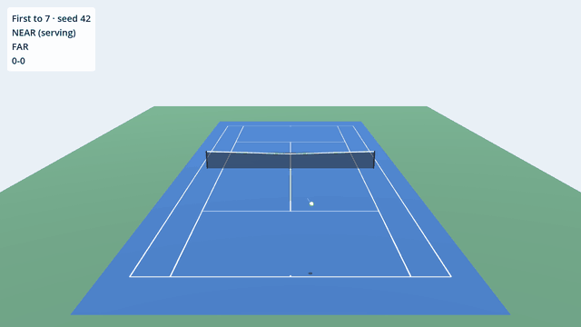

# 40 love

A minimalist, procedurally generated arcade tennis game for the browser, built
in Godot 4, with a deep, fighting-game-like shot system inspired by *Mario
Tennis Aces*. There are no imported assets: everything you see is generated in
code.

- **Play:** https://morbeo.github.io/40-love/play/
- **Devlog:** https://morbeo.github.io/40-love/ explains every step, the
  Godot features behind it, and the design decisions.



## Quick start

Linux or macOS with `bash`, `curl`, `git` and `unzip`:

```bash
./dev setup     # download the pinned Godot (.tools/) and GUT (addons/gut/)
./dev run       # watch two bots play; try --seed=7 --camera=side --format=best_of_3
./dev test      # run the test suite
./dev help      # everything else
```

To use your own Godot install instead: `GODOT=/path/to/godot ./dev test`.
To open the project in the editor, open `project.godot` with Godot 4.7.

Lint, format and docs need Python: `pip install -r requirements-dev.txt`.

## Layout

| Path | What |
|---|---|
| `src/sim/` | Pure, deterministic simulation. No nodes, no rendering |
| `src/view/` | Nodes that draw the sim |
| `scenes/` | Scene files |
| `test/` | GUT unit and integration tests |
| `tools/` | Headless scripts (devlog chart generator) |
| `docs/` | The devlog (MkDocs Material) |
| `dev` | Task runner, used locally and in CI |

## Contributing

See [CONTRIBUTING.md](CONTRIBUTING.md).

## License

MIT, see [LICENSE](LICENSE). GUT, downloaded into `addons/gut/`, is MIT
licensed by its authors.
