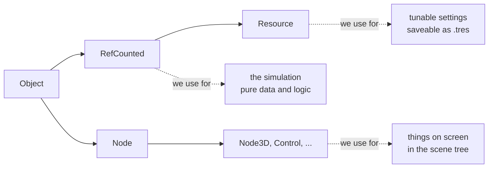
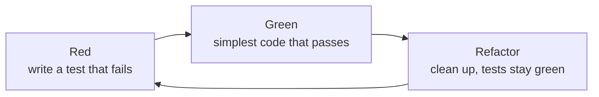

# #0 Setting up the workshop

*PR 1 of step 1. An empty Godot project with a test framework, a task runner,
and one tiny class with its first tests. Nothing playable yet. The point is
that every later PR lands on a foundation where `./dev check` proves things
work.*

!!! abstract "What you'll learn"
    - Which Godot project settings matter for this game, and why
    - `res://`, `.godot/`, `.uid` files and `.gdignore`
    - `class_name`, and choosing between **Node**, **Resource** and **RefCounted**
    - Writing and running unit tests with **GUT**, in the editor and headless
    - Linting GDScript, and a task runner that CI will reuse

## Read the code in this order

| # | File | What to look for |
|---|---|---|
| 1 | `project.godot` | The four settings explained below |
| 2 | `src/sim/side.gd` | `class_name`, constants, `static func` |
| 3 | `test/unit/test_side.gd` | What a GUT test looks like |
| 4 | `.gutconfig.json` | Where the test runner looks |
| 5 | `dev` | `./dev help`, then `cmd_setup` and `cmd_test` |
| 6 | `.gitignore`, `docs/.gdignore` | What stays out of git, and out of Godot |

## Design decisions so far

These came out of the planning quiz before any code was written:

| Question | Decision | Why |
|---|---|---|
| Engine | Godot 4.7 + GDScript | Learning Godot is a goal in itself. The 3D camera, gamepad input and web export all come built in. |
| Camera | Behind the baseline. Fake-3D vs real 3D decided by a spike in step 2 | Feel matters more than theory, so we'll play both. |
| Physics | Our own fixed-tick, deterministic simulation | Fighting-game frame data, replayable tests, netplay later. Godot's physics engine is not deterministic. |
| Architecture | A pure simulation core with a separate view | Makes test-driven development possible. |
| Assets | Zero. Everything procedural | Tiny download, nothing to license, and a fun constraint. |
| Platform | Desktop browser first, keyboard and gamepad | Mobile later. |

## The Godot project

A Godot project is any folder with a `project.godot` file in it. That file is
plain text (INI-style) and holds every setting from **Project → Project
Settings**. Ours is short; each line is there for a reason:

```ini
[application]
config/name="40 love"

[editor_plugins]
enabled=PackedStringArray("res://addons/gut/plugin.cfg")   ; the test framework

[physics]
common/physics_ticks_per_second=60   ; our simulation's tick rate
common/physics_interpolation=true    ; smooth drawing between ticks (devlog #6)

[rendering]
renderer/rendering_method="gl_compatibility"   ; same renderer everywhere
```

??? tip "Finding these in the editor"
    **Project → Project Settings**, then switch on **Advanced Settings** in the
    top right. Many settings, physics interpolation included, are hidden until
    you do. The search box at the top filters by name.

**Why the Compatibility renderer?** Godot 4 ships three renderers:
**Forward+** (desktop, high-end), **Mobile**, and **Compatibility** (OpenGL 3 /
WebGL 2). **Only Compatibility runs in a browser.** If we developed with
Forward+ and exported with Compatibility, the web build would look different
from the editor. Using Compatibility everywhere means the editor shows exactly
what players get. For a flat-coloured, minimalist look we lose nothing.

**Why 60 ticks per second?** The game logic will advance in fixed steps, like
frames in a fighting game. 60 is the standard, and it is also the default.
Writing it down makes it a deliberate choice that tests can rely on.

## Folder layout

```text
40-love/
├── project.godot          # project settings
├── .godot-version         # pinned engine version, read by ./dev and CI
├── dev                    # task runner: ./dev help
├── src/sim/               # the simulation: pure logic, no drawing
├── test/unit/             # one test file per class
├── addons/gut/            # test framework, downloaded by ./dev setup (not in git)
└── docs/                  # this devlog
```

Later PRs add `src/view/` (drawing), `scenes/`, `tools/` and `.github/`.

**`res://`** is Godot's name for the project folder. `res://src/sim/side.gd`
works the same on every machine and inside an exported game, where there is
no folder at all, just a packed `.pck` file.

**`.godot/`** is a cache Godot rebuilds whenever it likes: imported assets,
shader caches, and the global class list. It's in `.gitignore`.

**`*.uid` files** appear next to every script. Since Godot 4.4 each resource
has a stable ID, so references survive renames and moves. They *are*
committed. You'll see one per script in every PR from now on: that's normal.

**`.gdignore`**: an empty file with this name makes Godot skip a folder. The
devlog's images live in `docs/`, and without it Godot would import them and
ship them inside the game.

## Three kinds of objects

Almost everything you write in Godot extends one of three base classes.
Picking the right one is most of the architecture:



| | Node | Resource | RefCounted |
|---|---|---|---|
| Lives in the scene tree | yes | no | no |
| Gets `_process` / `_physics_process` | yes | no | no |
| Freed automatically | no, you call `queue_free()` | yes, when unreferenced | yes, when unreferenced |
| Editable in the Inspector, saveable to disk | as part of a scene | yes, as `.tres` | no |
| Cost to create thousands | high | low | lowest |

The simulation will be all **RefCounted**: plain objects the engine never
touches, so a test can create one, use it, and drop it. Settings will be
**Resources**. Only what's drawn on screen will be **Nodes**.

### Our first class

```gdscript
class_name Side
extends RefCounted

const NONE := -1
const NEAR := 0
const FAR := 1


static func other(side: int) -> int:
	return 1 - side
```

`Side` names the two ends of the court. NEAR is the player's end, where the
camera sits. It's deliberately boring, so this PR can focus on the tooling.

`class_name Side` registers the script as a **global type**: any other script
can write `Side.NEAR` without `preload(...)`. Godot keeps that list in
`.godot/global_script_class_cache.cfg`, which is built when the project is
**imported**. In a fresh checkout the file doesn't exist yet, so headless runs
must import first. That's why `./dev test` starts with `./dev import`.

## Testing with GUT

[GUT](https://github.com/bitwes/Gut) (Godot Unit Test) is the most widely used
test framework for GDScript. It's an **addon**: a folder of scripts under
`addons/` that Godot loads as an editor plugin. We pin **9.7.1**, the release
for Godot 4.7. `./dev setup` downloads it, so it isn't committed: it's 259 files
that aren't ours.

??? tip "Installing an addon from the editor instead"
    The usual route is the **AssetLib** tab at the top of the editor: search
    "GUT", download, install. Then enable it under **Project → Project
    Settings → Plugins**. A **GUT** panel appears at the bottom of the editor
    where you can run tests with a click. Our `project.godot` already lists the
    plugin as enabled, so after `./dev setup` the panel is just there.

A test file is a script that extends `GutTest`. Every method starting with
`test_` is a test:

```gdscript
extends GutTest

func test_other_side_flips() -> void:
	assert_eq(Side.other(Side.NEAR), Side.FAR)
	assert_eq(Side.other(Side.FAR), Side.NEAR)
```

GUT has the usual assertions (`assert_eq`, `assert_true`, `assert_almost_eq`
for floats), `before_each()` for fresh fixtures, and **parameterised tests**,
which you'll meet in the next PR. `.gutconfig.json` tells the command-line
runner where tests live and writes a JUnit XML report to `build/` for CI.

### The test-first loop

Every PR from here on follows the same rhythm:



### Running Godot headless

Godot can run without a window: `godot --headless`. Add `-s` and it runs a
script that extends `SceneTree` as the whole program:

```gdscript
extends SceneTree

func _init() -> void:
	print("hello from a headless Godot")
	quit()
```

That's how GUT runs from the command line: `godot --headless -s
addons/gut/gut_cmdln.gd`.

!!! warning "Gotcha: a parse error means a hang, not a crash"
    If an `-s` script (or any class it uses) fails to parse, Godot never calls
    `quit()` and **runs forever**. Every headless call in `./dev` is wrapped in
    `timeout`, so a typo fails loudly instead of hanging.

## Lint and format

[gdtoolkit](https://github.com/Scony/godot-gdscript-toolkit) gives us `gdlint`
(naming, ordering, line length) and `gdformat` (an opinionated formatter, like
Black for Python). Its config is `gdlintrc`. Install the Python tools with
`pip install -r requirements-dev.txt`.

## The `./dev` task runner

One script, used by you now and by CI later, so "works on my machine" and
"works in CI" mean the same thing:

| Command | What it does |
|---|---|
| `./dev setup` | Download the pinned Godot into `.tools/` and GUT into `addons/gut/` |
| `./dev test` | Import, then run every GUT test. `./dev test -gselect=test_side` runs one file |
| `./dev lint` / `./dev fmt` | Check / fix style |
| `./dev check` | Lint + test |
| `./dev docs serve` | Preview this devlog at http://127.0.0.1:8000 |

Set `GODOT=/path/to/godot` to use your own Godot install instead. Later PRs
add commands as they need them (`media`, `run`, `web`).

The help text is generated from the script itself: every `cmd_name() { # text`
line becomes a row. Adding a command is one function.

## Try it yourself

1. `./dev setup && ./dev check`. You should see 4 passing tests.
2. Open the project in the editor (`.tools/Godot_v4.7.2-stable_linux.x86_64 -e`,
   or your own Godot 4.7). Find the **GUT** panel at the bottom and run the
   tests there.
3. Make a test fail on purpose: change `other()` to `return side`. Read GUT's
   failure message, then put it back.
4. Write a fifth test: `Side.other(Side.other(x)) == x` for both sides.
