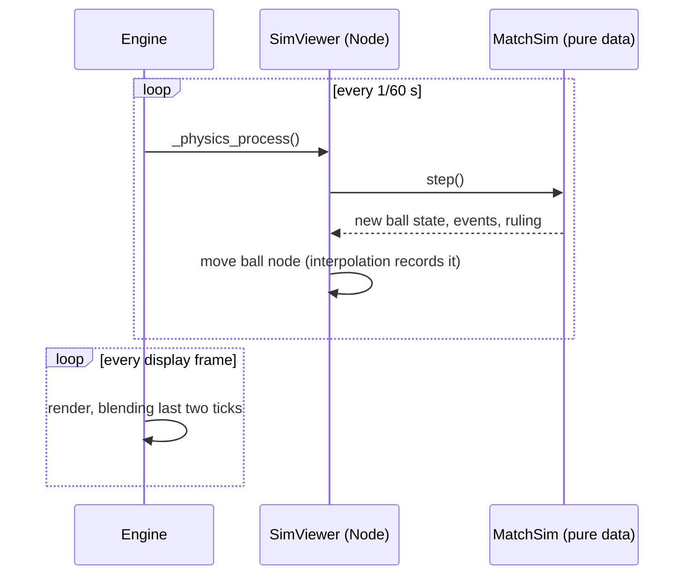
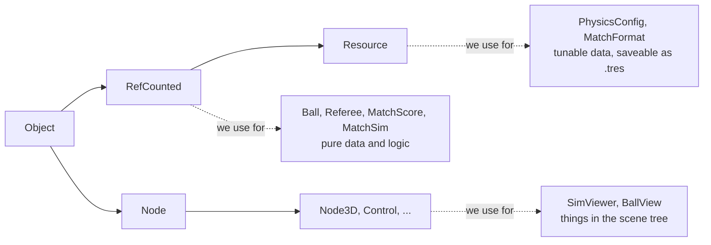
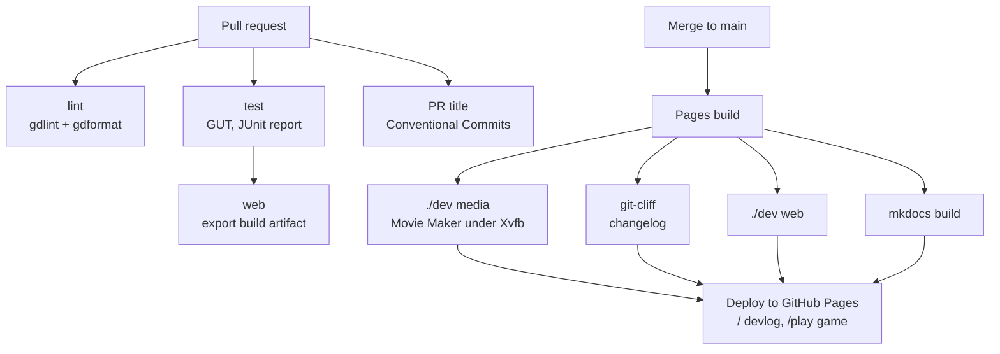

# #0 Setting up the workshop

*Step 1, part 1. Covers the Godot project, the folder layout, testing with GUT,
linting, the `./dev` task runner, and the CI/CD pipeline that publishes this
devlog and the game.*

!!! abstract "What you'll learn"
    - Which Godot project settings matter for this game, and why
    - `res://`, `.godot/`, `.uid` files and `.gdignore`
    - `class_name`, and choosing between **Node**, **Resource** and **RefCounted**
    - Writing and running unit tests with **GUT**
    - Running Godot headless, from scripts and in CI
    - Recording footage automatically with **Movie Maker mode**

## Design decisions so far

These came out of the planning quiz before any code was written:

| Question | Decision | Why |
|---|---|---|
| Engine | Godot 4.7 + GDScript | Learning Godot is a goal in itself. The 3D camera, gamepad input and web export all come built in. |
| Camera | Behind the baseline, like the inspiration. Fake-3D vs real 3D to be decided by a spike in step 2 | Feel matters more than theory, so we'll play both. |
| Physics | Our own fixed-tick, deterministic simulation | Fighting-game-style frame data, replayable tests, and netplay later. Godot's physics engine is not deterministic. |
| Architecture | A pure simulation core with a separate view | Makes test-driven development possible (see [#1](001-sim-core.md)). |
| Assets | Zero. Everything procedural | Tiny download, nothing to license, and a fun constraint. |
| Platform | Desktop browser first, keyboard and gamepad | Mobile later. |

## The Godot project

A Godot project is any folder with a `project.godot` file in it. That file is
plain text (INI-style) and holds every setting from **Project → Project
Settings**. Ours is short; each line is there for a reason:

```ini
[application]
run/main_scene="res://scenes/sim_viewer.tscn"   ; what F5 / the web build opens

[physics]
common/physics_ticks_per_second=60   ; our sim's tick rate (see below)
common/physics_interpolation=true    ; smooth rendering between ticks

[rendering]
renderer/rendering_method="gl_compatibility"   ; same renderer everywhere
```

??? tip "Finding these in the editor"
    **Project → Project Settings**, then switch on **Advanced Settings** in the
    top right. Many settings, physics interpolation included, are hidden until
    you do. The search box at the top filters by name.

### Why the Compatibility renderer?

Godot 4 ships three renderers: **Forward+** (desktop, high-end), **Mobile**,
and **Compatibility** (OpenGL 3 / WebGL 2). **Only Compatibility runs in a
browser.** If we developed with Forward+ and exported with Compatibility,
lighting, shadows and post effects would look different on the web than in
the editor. Using Compatibility everywhere means the editor shows exactly what
players get. For a flat-coloured, minimalist look we lose nothing.

### Ticks, frames and physics interpolation

Godot calls two different callbacks on every node that wants them:

| Callback | When | Rate | We use it for |
|---|---|---|---|
| `_physics_process(delta)` | Fixed steps | `physics_ticks_per_second` (60) | Advancing the simulation by one tick |
| `_process(delta)` | Once per rendered frame | Whatever the monitor runs (60, 144, ...) | Nothing yet (later: UI animation) |

On a 144 Hz screen several frames render between two ticks. Without help,
the ball would visibly "step". **Physics interpolation** fixes this: Godot
remembers each node's transform at the last two ticks and blends between them
on every frame. We only ever move nodes inside `_physics_process`, and Godot
does the smoothing.



When the ball teleports (a new point starts), blending would draw a streak
across the court. `reset_physics_interpolation()` tells Godot "don't blend
this one"; see `BallView.snap()`.

## Folder layout

```text
40-love/
├── project.godot          # project settings
├── export_presets.cfg     # how to build for the Web
├── .godot-version         # pinned engine version (4.7.2), read by ./dev and CI
├── dev                    # task runner: ./dev help
├── src/
│   ├── sim/               # pure simulation: no Nodes, no drawing
│   │   └── bots/          # AutoHitter, the ball-machine bot
│   └── view/              # Nodes that draw the sim
├── scenes/                # .tscn scene files
├── test/
│   ├── unit/              # one test file per sim class
│   └── integration/       # whole-match tests
├── tools/                 # headless scripts (chart generator)
├── addons/gut/            # the GUT test framework, vendored
├── docs/                  # this devlog (MkDocs)
└── .github/               # CI/CD workflows
```

**`res://`** is Godot's name for the project folder. `res://src/sim/ball.gd`
works the same on every machine and inside an exported game, where there is
no folder at all, just a packed `.pck` file.

**`.godot/`** is a cache Godot rebuilds whenever it likes: imported assets,
shader caches and the global class list. It's in `.gitignore`.

**`*.uid` files** (Godot 4.4+) give every script a stable ID, so references
survive renames and moves. They *are* committed.

**`.gdignore`**: an empty file with this name makes Godot skip a folder
entirely. We put one in `docs/` and `build/`. We learned this the hard way:
the first web export was 4 MB because Godot had imported 150 screenshots from
`build/` and packed them into the game. With `.gdignore` the game data is **40 KB**.

## Three kinds of objects

Almost everything you write in Godot extends one of three base classes.
Picking the right one is most of the architecture:



| | Node | Resource | RefCounted |
|---|---|---|---|
| Lives in the scene tree | yes | no | no |
| Gets `_process` / `_physics_process` | yes | no | no |
| Freed automatically | no, you call `queue_free()` | yes, when unreferenced | yes, when unreferenced |
| Editable in the Inspector, saveable to disk | as part of a scene | yes, as `.tres` | no |
| Cost to create thousands | high | low | lowest |

The simulation is all **RefCounted**: plain objects that the engine never
touches, so a test can create one, step it, and throw it away. Configuration
is **Resource**, so you can later make a `clay.tres` physics profile and tweak
it in the Inspector without touching code. Only the view is made of **Nodes**.

### `class_name`: global names

```gdscript
class_name Ball
extends RefCounted
```

`class_name` registers the script as a global type. Any other script can write
`Ball.new()` or `var b: Ball` without `preload(...)`. Godot keeps the list in
`.godot/global_script_class_cache.cfg`, which is built when the project is
**imported**. In a fresh checkout that file doesn't exist yet, so headless
runs must import first. That's why `./dev test` starts with `./dev import`.

## Testing with GUT

[GUT](https://github.com/bitwes/Gut) (Godot Unit Test) is the most widely used
test framework for GDScript. It's an *addon*: a folder of scripts under
`addons/` that Godot loads as an editor plugin. We vendor it (commit the
folder) and pin **9.7.1**, the release for Godot 4.7.

??? tip "Installing an addon in the editor"
    The usual route is the **AssetLib** tab at the top of the editor: search
    "GUT", download, install. Then enable it under **Project → Project
    Settings → Plugins**. After that a **GUT** panel appears at the bottom of
    the editor where you can run tests with a click. We committed the folder
    instead, so CI and every checkout get exactly the same version.

A test file is a script that extends `GutTest`. Every method starting with
`test_` is a test:

```gdscript
extends GutTest

func test_deuce_needs_two_clear_points() -> void:
	var s := MatchScore.new(MatchFormat.one_set())
	_win(s, Side.NEAR, 3)
	_win(s, Side.FAR, 3)
	s.point_won(Side.NEAR)
	s.point_won(Side.FAR)
	assert_eq(s.games, [0, 0], "back to deuce")
	_win(s, Side.FAR, 2)
	assert_eq(s.games, [0, 1])
```

**Parameterised tests** run once per row, which is great for rules that are
symmetric (four service boxes, three spins...):

```gdscript
func test_serves_go_diagonally(
	p = use_parameters([
		[Side.NEAR, true, Vector3(-2, 0, -3)],
		[Side.NEAR, false, Vector3(2, 0, -3)],
		[Side.FAR, true, Vector3(2, 0, 3)],
		[Side.FAR, false, Vector3(-2, 0, 3)],
	])
) -> void:
```

`before_each()` runs before every test (fresh fixtures). `.gutconfig.json` at the
project root tells the command-line runner where tests live and writes a JUnit
XML report to `build/` for CI.

### Running Godot headless

Godot can run without a window: `godot --headless`. Combined with `-s`, it
runs a script that extends `SceneTree` (or `MainLoop`) as the whole program:

```gdscript
extends SceneTree

func _init() -> void:
	print("hello from a headless Godot")
	quit()
```

That's how GUT runs from the command line (`-s addons/gut/gut_cmdln.gd`), and
how `tools/plot_trajectories.gd` generates the charts in [#1](001-sim-core.md).

!!! warning "Gotcha: a parse error means a hang, not a crash"
    If an `-s` script (or any class it uses) fails to parse, Godot prints
    nothing useful, never calls `quit()`, and **runs forever**. Our first smoke
    test hung on a type-inference error. The fix: every headless call in `./dev`
    is wrapped in `timeout`, so CI fails loudly instead of burning an hour.

## Lint and format

[gdtoolkit](https://github.com/Scony/godot-gdscript-toolkit) gives us `gdlint`
(naming, ordering, line length) and `gdformat` (an opinionated formatter, like
Black for Python). Config lives in `gdlintrc`. `./dev fmt` formats everything;
`./dev lint` fails if anything would change.

## The `./dev` task runner

One script, used by you and by CI, so "works on my machine" and "works in CI"
are the same thing:

| Command | What it does |
|---|---|
| `./dev setup` | Download the pinned Godot into `.tools/` |
| `./dev run --seed=7 --camera=side` | Open the debug viewer |
| `./dev test` | Import, then run every GUT test. `./dev test -gselect=test_court` runs one file |
| `./dev lint` / `./dev fmt` | Check / fix style |
| `./dev check` | Lint + test: what CI runs |
| `./dev media` | Regenerate charts, screenshots and GIFs for the devlog |
| `./dev templates` | Install the Web export templates |
| `./dev web` | Export the Web build to `build/web/` |
| `./dev docs serve` | Preview this devlog locally |

Set `GODOT=/path/to/godot` to use your own Godot binary instead of the
downloaded one.

## Exporting for the Web

Exporting needs **export templates**: prebuilt engine binaries for each
platform. The full download is 1.3 GB, but the web build only needs
`web_nothreads_release.zip` (10 MB), so `./dev templates` keeps just that.

`export_presets.cfg` (written by **Project → Export...**) holds one preset
called `Web`. Two options worth knowing:

- `variant/thread_support=false`: a threaded web build needs special HTTP
  headers (cross-origin isolation) that GitHub Pages can't send. The
  single-threaded build runs anywhere.
- `exclude_filter="test/*, tools/*, docs/*, addons/gut/*"`: tests and tools
  stay out of the shipped game.

The result is about 10 MB gzipped: almost all of it is the engine itself, and
the game is 40 KB.

## CI/CD



- **`ci.yml`** runs on every PR: lint, tests, and a web export to prove the
  game still builds.
- **`pr-title.yml`** checks the PR title follows
  [Conventional Commits](https://www.conventionalcommits.org) (`feat:`,
  `fix(sim):`, `docs:`...). The squash-merge commit uses the PR title, and the
  changelog is generated from those commits.
- **`pages.yml`** runs on `main`: regenerates media, builds the changelog with
  [git-cliff](https://git-cliff.org), exports the game, builds this site with
  [MkDocs Material](https://squidfunk.github.io/mkdocs-material/), and deploys
  both.
- **`.github/actions/setup-godot`** is a *composite action*: our own reusable
  step that installs Godot and templates, with caching keyed on
  `.godot-version`. Bumping the engine is a one-line change.

### Footage without a screen: Movie Maker mode

Godot can render a game to image files instead of a window:

```bash
godot --write-movie out/frame.png --fixed-fps 30 --quit-after 300 -- --seed=42
```

`--fixed-fps` makes the engine pretend exactly 1/30 s passes per frame, however
long a frame really takes to render. Combined with our deterministic sim, **the
same command always produces the same frames**. CI has no GPU or monitor, so
`./dev media` runs Godot under **Xvfb** (a virtual X display) with Mesa's
software OpenGL, then `ffmpeg` turns the frames into a GIF with a two-pass
palette for small files.

## Try it yourself

1. Run `./dev setup && ./dev run`, then open the project in the Godot editor
   (`.tools/Godot_v4.7.2-stable_linux.x86_64 -e`, or your own install).
2. In the editor, open the GUT panel at the bottom and run all tests. Then
   break one on purpose: change `Court.SERVICE_LINE` to `6.0` and see which
   tests catch it.
3. Turn off **Physics → Common → Physics Interpolation**, set your monitor to
   its highest refresh rate, and watch the ball. Can you see it stutter?
4. Run `./dev run --camera=high` for a top-down view of the bots.
