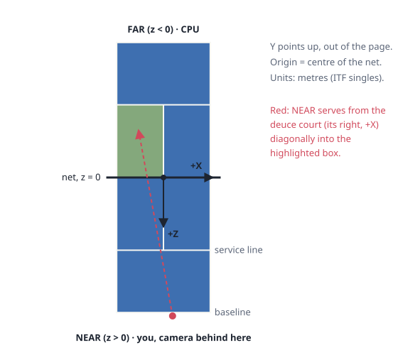

# #1 The court and its coordinates

*PR 2 of step 1. Where things are: Godot's 3D axes, a real tennis court
mapped onto them, and the first rules, which are line calls and service boxes.*

!!! abstract "What you'll learn"
    - Godot's 3D coordinate conventions, and why our court is laid out this way
    - Keeping geometry as pure `static func`s, so it can be tested without a scene
    - Parameterised tests in GUT
    - A float-precision trap that every Godot project hits eventually

## Read the code in this order

| # | File | What to look for |
|---|---|---|
| 1 | `src/sim/court.gd` | Constants at the top, then four small functions |
| 2 | `test/unit/test_court.gd` | `use_parameters` in `test_serves_go_diagonally` |

## Axes



Godot 3D is **Y-up** and **right-handed**, and a camera looks along its own
**-Z**. We put the origin at the centre of the net, X across the court and Z
along it. The player's half (`Side.NEAR`) is +Z, so a camera behind the +Z
baseline looks towards -Z: Godot's natural "forward". No rotations are needed
anywhere.

Units are metres, with real ITF singles dimensions:

```gdscript
const LENGTH := 23.77
const SINGLES_WIDTH := 8.23
const SERVICE_LINE := 6.40        # distance from the net
const NET_HEIGHT_CENTER := 0.914
const NET_HEIGHT_POST := 1.07
```

Using real sizes means real tennis intuition applies (a 100 km/h shot takes
about a second to cross the court). Any arcade exaggeration will be a
deliberate tuning choice, not an accident of units.

## Pure functions

`Court` has no state. Everything is a `static func` you call on the class
itself, `Court.is_in_singles(p)`, with no instance needed:

| Function | Answers |
|---|---|
| `net_height_at(x)` | How high is the tape here? (it sags towards the middle) |
| `is_in_singles(p)` | Did this bounce land in? |
| `service_box(server, deuce_court)` | Which box must this serve land in? |
| `serve_position(server, deuce_court)` | Where does the server stand? |

Lines are **in**: court dimensions are measured to the *outer* edge of the
lines, so a ball whose centre is exactly on a boundary counts.

### The deuce court

The fiddliest rule. A server stands to the **right** of the centre mark for
the deuce court, and serves diagonally. "Right" depends on which way you face:
NEAR faces -Z, so its right is +X; FAR faces +Z, so its right is -X. One
line covers all four cases:

```gdscript
var x_sign := (-1.0 if deuce_court else 1.0) * Side.sign_of(server)
```

Exactly the kind of thing that's easy to get backwards and hard to spot by
eye. So the test checks all four combinations with one **parameterised test**:

```gdscript
func test_serves_go_diagonally(
	p = use_parameters([
		[Side.NEAR, true, Vector3(-2, 0, -3)],
		[Side.NEAR, false, Vector3(2, 0, -3)],
		[Side.FAR, true, Vector3(2, 0, 3)],
		[Side.FAR, false, Vector3(-2, 0, 3)],
	])
) -> void:
	var inside: Vector3 = p[2]
	assert_true(Court.is_in_service_box(inside, p[0], p[1]))
	# Mirroring X lands in the wrong box; mirroring Z lands on the server's side.
	assert_false(Court.is_in_service_box(Vector3(-inside.x, 0, inside.z), p[0], p[1]))
```

GUT runs the function once per row and reports each row separately. The
default argument `p = use_parameters([...])` is GUT's convention for this.

## Gotcha: 32-bit vectors, 64-bit constants

The first version of `test_lines_are_in` failed. The test put a bounce exactly
on the sideline, `Vector3(Court.HALF_WIDTH, 0, 0)`, and it was called **out**.

`float` in GDScript is 64-bit, but `Vector3` stores **32-bit** floats. 4.115
doesn't have an exact binary representation; rounded to 32 bits it becomes
4.11500025..., just *outside* the 64-bit constant. So line checks now allow
one millimetre of slack:

```gdscript
const EPSILON := 0.001
return absf(p.x) <= HALF_WIDTH + EPSILON and absf(p.z) <= HALF_LENGTH + EPSILON
```

Remember this one. It will come back when we compare simulation results
across machines for netplay.

## Try it yourself

1. Add a test: is a bounce on the **centre service line** in for both
   service boxes? (It should be: lines are in.)
2. Make the net flat (`NET_HEIGHT_POST = NET_HEIGHT_CENTER`). Which test catches it?
3. Remove `EPSILON` from `is_in_singles` and run `./dev test -gselect=test_court`
   to see the precision failure for yourself.
