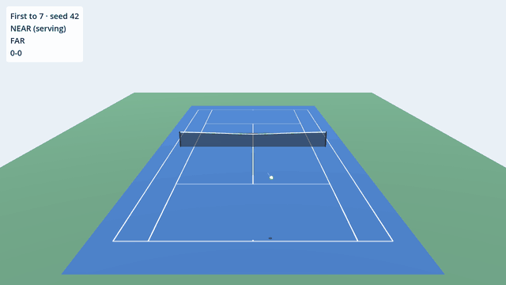
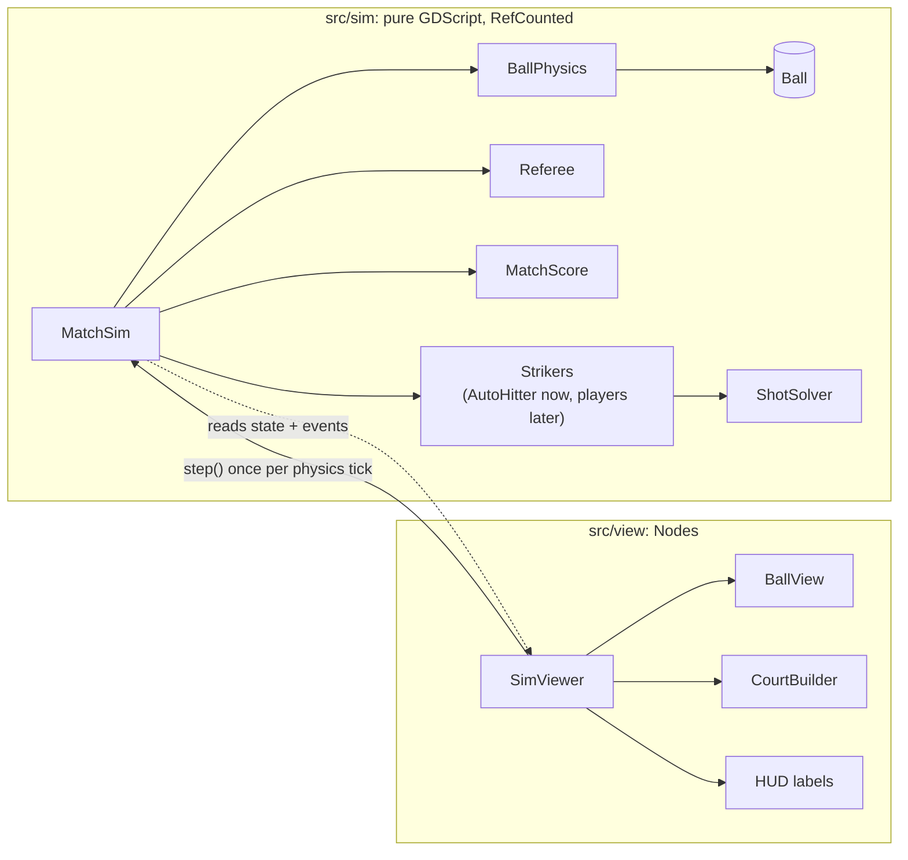
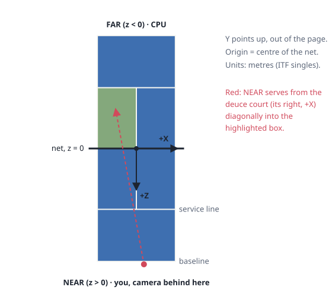
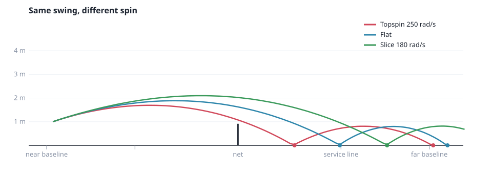
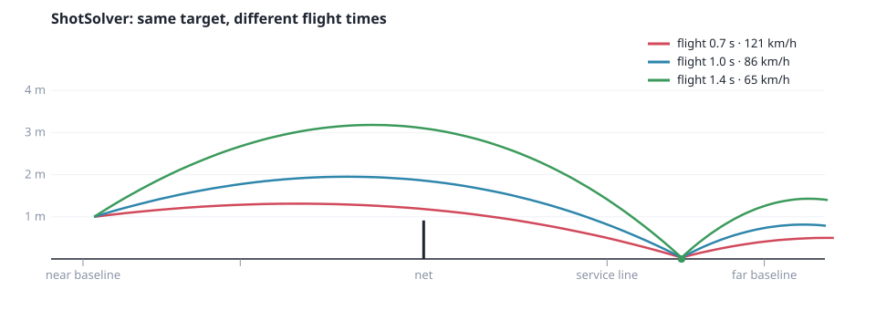
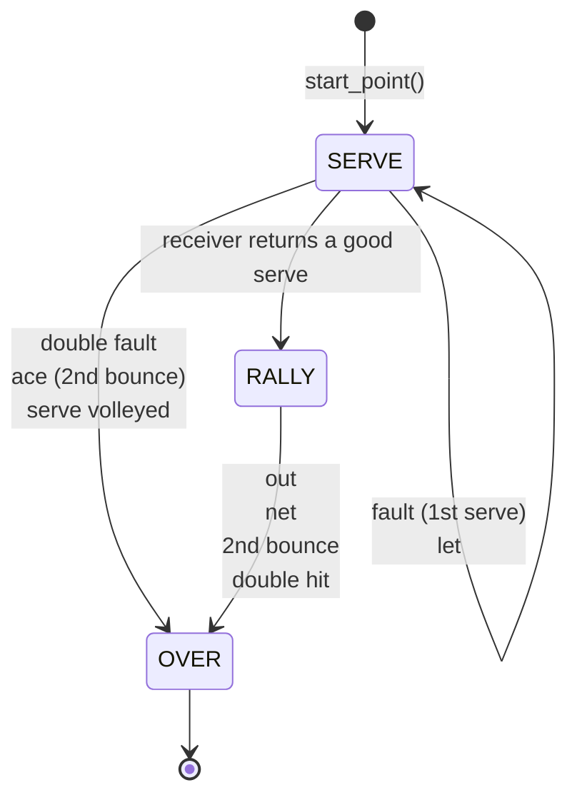
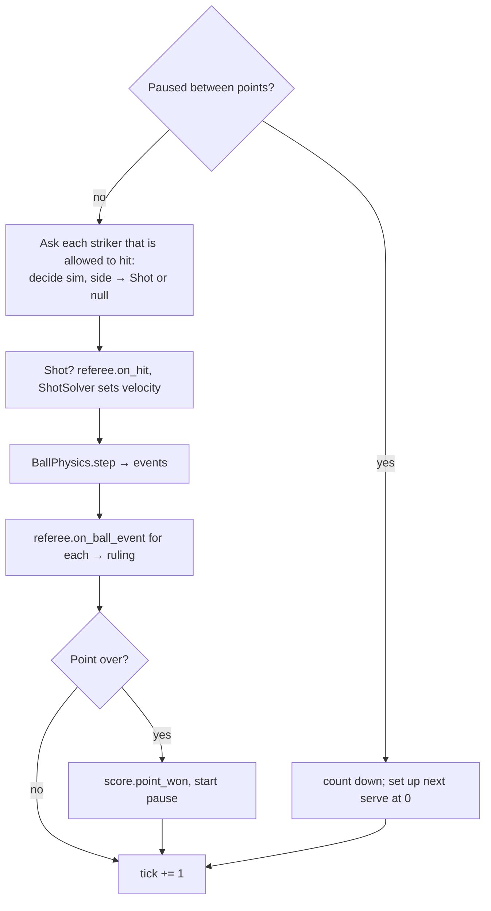
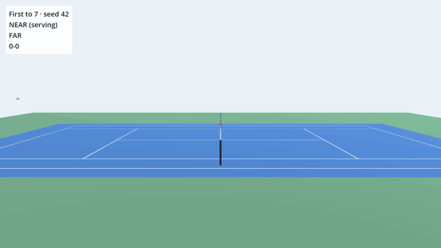

# #1 The simulation core

*Step 1, part 2. A complete tennis match (ball physics with spin, the net,
line calls, faults, lets and scoring up to five sets) that plays itself and
replays identically from a seed. There are no players yet. Two "ball machine"
bots trade shots so we can watch and test everything else.*



!!! abstract "What you'll learn"
    - Why the game logic lives outside the scene tree, fighting-game style
    - Godot's 3D axes, and how we map a tennis court onto them
    - Ball flight with drag and the Magnus effect, and a spin-aware bounce
    - Turning physics events into tennis rulings with a small state machine
    - Testing for determinism, including a "golden master" match
    - Building a 3D scene entirely from code

## The big idea: simulation and view

Fighting games run on a strict loop: read inputs, advance the game state by
exactly one frame, draw it. Game state never depends on how fast the screen
renders. Everything we want from Aces-style mechanics needs that: frame data,
hit windows, perfect-timing bonuses, replays, maybe online play.

So the game is split in two:



The **sim** knows nothing about Godot nodes, rendering or time passing. It
only has `step()`. The **view** reads the sim after each step and moves meshes
around. Consequences:

- **Tests are instant.** A whole one-set match (about 75,000 ticks) simulates in
  under a second, with no window and no waiting.
- **Determinism is achievable.** The sim's only randomness is a seeded
  `RandomNumberGenerator`, and its only clock is the tick counter.
- **The view is replaceable.** Step 2 tries two different cameras over the
  *same* sim.

## Court and coordinates



Godot 3D is **Y-up** and **right-handed**, and the "forward" direction of a
camera is **-Z**. We put the origin at the centre of the net, X across the
court, Z along it. The player's half (`Side.NEAR`) is +Z, so the camera sits
behind the +Z baseline looking towards -Z. That is Godot's natural forward,
so no rotations are needed.

`Court` (`src/sim/court.gd`) holds real ITF singles dimensions as constants and
answers pure questions: *is this bounce in?*, *which service box?*, *how high
is the net here?* The net sags from 1.07 m at the posts to 0.914 m in the
middle, and we model that as a straight line.

The deuce/ad rule is the fiddliest part. A server stands on their **right**
for the deuce court and serves diagonally. NEAR faces -Z, so its right is
+X; FAR faces +Z, so its right is -X. `Court.service_box()` encodes that in
one line with `Side.sign_of()`, and a parameterised test checks all four
combinations.

## The ball

`Ball` is plain data: `position`, `velocity`, `spin`, and `held` (the server's
toss). Spin is a proper **angular velocity vector**: its direction is the
rotation axis, its length is the rate in rad/s. Two helpers translate to tennis
language:

```gdscript
## Positive is topspin, negative is backspin (slice).
func topspin() -> float:
	var d := Vector3(velocity.x, 0.0, velocity.z)
	return spin.dot(Vector3.UP.cross(d.normalized()))
```

For a ball travelling along direction **d**, topspin rotates about the axis
**up × d**. Keeping spin as a real vector, not "a topspin number", means
sidespin, curve and the bounce all fall out of the same maths.

### In the air

Three accelerations act on the ball each tick (`BallPhysics.air_acceleration`):

```gdscript
var a := Vector3(0.0, -cfg.gravity, 0.0)  # gravity
a -= v * v.length() * cfg.drag             # drag, grows with speed squared
a += ball.spin.cross(v) * cfg.magnus       # Magnus: spin bends the path
```

**Magnus** is why topspin dips and slice floats. Spinning drags air around
the ball, so the air pressure is lower on one side than the other. With
topspin, `spin × velocity` points *down*. Here are three shots with the
*identical* launch velocity, differing only in spin, computed by the real sim:



The ball is advanced with **semi-implicit Euler**:

```gdscript
ball.velocity += air_acceleration(ball, cfg) * dt   # 1. velocity first
ball.position += ball.velocity * dt                  # 2. then move with the NEW velocity
```

Swapping those two lines gives plain ("explicit") Euler, which slowly *adds*
energy to anything that bounces or orbits. Semi-implicit Euler costs the same
and stays stable. It's the default in most game physics engines for that
reason.

### The bounce

Bounces are where spin earns its keep. Vertically it's simple: the ball keeps
`restitution` (75%) of its downward speed, reversed. Horizontally, friction acts
on the **slip**: how fast the bottom of the ball skids over the court. That
is the ball's velocity plus the surface speed its spin gives the contact
point:

```gdscript
var contact := Vector3(0.0, -r, 0.0)               # bottom of the ball
var slip := v_t + ball.spin.cross(contact)         # contact-point velocity
var max_friction := cfg.friction * (1.0 + cfg.restitution) * absf(vy)
var to_rolling := 0.4 * slip_speed                 # can't overshoot pure rolling
dv_t = -slip / slip_speed * minf(max_friction, to_rolling)
```

- **Topspin** moves the bottom of the ball *backwards*, cancelling some slip.
  Less braking, and a heavy topspin ball can even be pushed forwards: the
  **kick**.
- **Backspin** adds slip. The ball brakes and leaves still skidding.
- The same friction impulse also changes the spin: `Δω = (contact × Δv) ·
  3 / (2r²)`. The 3/2 comes from the moment of inertia of a hollow sphere,
  and so does the 2/5 cap on how much friction can do before the ball is
  simply rolling.

!!! note "A test that corrected my intuition"
    I first wrote a test asserting *slice loses more pace than flat on the
    bounce*. It failed: both came out at exactly 13.7 m/s. That's correct
    physics. Both balls slide for the whole contact, so Coulomb friction brakes
    them by the same amount. What actually differs is the spin they leave with,
    and how low slice arrives in the first place (it floats, then lands at a
    shallower angle). The test now asserts what's true, and if we later want
    an *arcade* slice that skids harder than physics allows, that'll be a
    deliberate, named tuning knob.

### The net

Each tick we compare the ball's Z before and after moving. If the sign
changed, the ball crossed the net plane, and linear interpolation finds where:

```gdscript
var t := prev.z / (prev.z - ball.position.z)
var hit := prev.lerp(ball.position, t)
var under_tape := hit.y - cfg.ball_radius < Court.net_height_at(hit.x)
```

Clipping the tape kills 85% of the ball's speed and drops it back on the
hitter's side, a `NET_HIT` event. A clean pass is a `NET_CROSS` event. At 60
ticks per second a 30 m/s ball moves 50 cm per tick, so without the
interpolation, fast balls would tunnel straight through the net.

### Events, not signals

`BallPhysics.step()` returns an array of `BallEvent`s: `BOUNCE`, `NET_HIT`,
`NET_CROSS`, each with tick, position and side. Godot's **signals** would
also work (any `Object` can declare them, `RefCounted` included), but plain
return values are easier to test and keep a guaranteed order. That matters
when one tick contains both a net crossing and a bounce. The view can still
turn events into signals for sounds and particles later.

## Aiming: the shot solver

A player (or bot) doesn't think in velocities. They think "*deep to the
backhand corner, hit hard, with topspin*". `Shot` captures exactly that:
`target`, `flight_time`, `topspin`, `sidespin`. `ShotSolver` converts it into
a launch velocity.

With drag and Magnus there's no closed-form answer, so it uses the
**shooting method**: guess, simulate the flight with the real air model,
measure the miss, correct, repeat. Twelve rounds land within millimetres:

```gdscript
for i in ITERATIONS:
	var landing := simulate_landing(from, v, spin, cfg)   # x, flight time, z
	var miss := Vector3(target.x - landing.x, 0.0, target.z - landing.z)
	v.x += miss.x / t
	v.z += miss.z / t
	v.y += (t - landing.y) * cfg.gravity * 0.5            # fix the timing
```

**Flight time** is how "power" will work for shots: the same target, reached
sooner, means a harder and flatter shot:



This is the bridge to the Aces shot system in step 3. Each shot type will
be a recipe for `flight_time`, spin and target offset, scaled by charge and
character stats.

## The referee

The rules of one point are a small state machine (`src/sim/referee.gd`). It
consumes two kinds of input, `on_hit(side)` and `on_ball_event(e)`, and
answers each with a `Ruling`: nothing, `FAULT`, `LET`, or `POINT` with a
winner and a reason.



Between those, it tracks just four facts since the last hit: who hit it, has
it **crossed** the net, how many times has it **bounced** on the far side,
and did it **touch the net**. Every rule of tennis we need falls out of
those:

| Situation | Ruling |
|---|---|
| First bounce in the opponent's court (service box when serving) | play on |
| First bounce outside it | `OUT` (or a fault on a serve) |
| Ball bounces on the hitter's own side (it never crossed) | `NET` (or a fault) |
| Second bounce anywhere | point to the last hitter |
| Serve clips the net and lands in | `LET`, same serve again |
| Receiver hits the serve before it bounces | point to the server |
| Same side hits twice | point to the other side |

`Ruling` is an **inner class**, a `class` declared inside another script.
From outside it's `Referee.Ruling`. That's handy for small types that only
make sense next to their owner.

## Scoring

`MatchScore` is tennis's odd counting system as code: points → games → sets
→ match, with deuce/advantage (or no-ad), tiebreaks at 6-all, and who serves
from which side. Formats are a **Resource** (`MatchFormat`) with presets:

| Preset | Rules |
|---|---|
| `quick_tiebreak()` | First to 7 points, win by 2. **The v1 default** |
| `first_to(n)` | First to *n*, optionally without win-by-two |
| `one_set()` | Six games, tiebreak at 6-6 |
| `best_of(3)`, `best_of(5)` | Proper sets |

Tiebreak serving is the classic trap: the first server takes one point, then
players alternate every **two** points (A, BB, AA, BB...). Once you see it,
it's one line:

```gdscript
var block := (points_so_far + 1) / 2
return first_server if block % 2 == 0 else other(first_server)
```

## Putting it together: `MatchSim`

`MatchSim.step()` is the heartbeat. One tick:



A **striker** is anything with a `decide(sim, side) -> Shot` method. GDScript
lets us rely on that shape without declaring an interface ("duck typing"). In
step 1 both sides are `AutoHitter`: a bot with no body that hits any ball
falling below 1 m after its bounce, aims at a random spot with a random spin
style, and deliberately misses 12% of the time. Players and the CPU will
plug into the same slot.

## Determinism, tested

All randomness goes through `sim.rng`, a `RandomNumberGenerator` with a fixed
`seed`. Two tests guard it:

```gdscript
func test_same_seed_replays_identically() -> void:
	var a := _bot_match(42)
	var b := _bot_match(42)
	for i in 3000:
		a.step()
		b.step()
		if a.state_hash() != b.state_hash():
			fail_test("diverged at tick %d" % i)
			return
```

Comparing a hash **every tick**, not just at the end, means a failure points at
the exact tick where two runs split.

The second is a **golden master**: seed 42, one set, must finish **4-6 after
75 points**. Any change to physics, rules or the bot changes that result. That
can be fine, but then you update the expected values *on purpose* and say why
in the commit.

!!! warning "Gotcha: 32-bit vectors, 64-bit constants"
    `float` in GDScript is 64-bit, but `Vector3` stores 32-bit floats. A test
    put a bounce exactly on the sideline: `Vector3(Court.HALF_WIDTH, 0, 0)`.
    Stored in 32 bits, 4.115 became 4.11500025..., just *outside* the 64-bit
    constant, so the ball was called out. Line checks now allow 1 mm of
    slack (`Court.EPSILON`). The same issue will matter for netplay: the same
    binary gives the same results, but different CPUs or a WebAssembly build
    can round differently.

## The viewer: a scene built from code

`scenes/sim_viewer.tscn` contains a single node with a script. Everything
else, including camera, light, court, net, ball, shadow, trail and HUD, is created in
`_ready()`:

- **`CourtBuilder`** makes the court from `PlaneMesh` and `BoxMesh`, sized
  from the same `Court` constants the referee uses. Lines are boxes 5 cm wide
  and 2 mm tall, lifted 2 mm to avoid **z-fighting**: two surfaces at the same
  depth flicker as the GPU can't decide which is in front.
- **`BallView`** draws the ball 2.2x real size (real tennis balls are
  invisible at broadcast distance, and every tennis game cheats this), a dark
  disc directly below it as a **shadow** (the most important depth cue in any
  3D ball game, and cheaper than real shadow mapping), and a fading **trail**
  rebuilt every tick with `ImmediateMesh`, Godot's API for geometry that
  changes every frame.
- **`Palette`** holds every colour. One `StandardMaterial3D` per colour, no
  textures anywhere.
- The HUD is a `CanvasLayer` (always drawn on top, unaffected by the 3D camera)
  with a `PanelContainer` and `Label`s.

Command-line arguments after a lone `--` reach the game through
`OS.get_cmdline_user_args()`: `./dev run --seed=7 --format=best_of_3 --camera=side`.



## Test inventory

| File | Tests | Covers |
|---|---|---|
| `unit/test_court.gd` | 5 (one runs 4 cases) | Net height, lines in/out, service boxes, serve positions |
| `unit/test_ball_physics.gd` | 11 | Gravity, bounce, spin kick, Magnus dip/float/curve, net, determinism |
| `unit/test_shot_solver.gd` | 2 (one runs 5 cases) | Lands on target for every spin style; flight time = power |
| `unit/test_referee.gd` | 12 | Serves, faults, lets, aces, volleys, outs, net, double hits |
| `unit/test_match_score.gd` | 15 | Games, deuce, no-ad, sets, tiebreaks, serve rotation, presets |
| `integration/test_match_sim.gd` | 6 | Full bot matches, replay determinism, golden master |

51 tests, about 2 seconds.

## Try it yourself

1. **Bouncier court.** In `physics_config.gd`, set `restitution` to `0.9` and
   run `./dev run`. Then run `./dev test` and see which tests object.
   The golden master will, and that's its job.
2. **Clay vs grass.** Create a `PhysicsConfig` in the editor (**FileSystem →
   right-click → New Resource → PhysicsConfig**), raise `friction`, save it as
   `clay.tres`. Then write a test: *topspin kicks higher on clay than on the
   default court*.
3. **Perfect bots.** Set `AutoHitter.error_rate` to `0.0`. Rallies drag on
   until someone clips the net, because bots have no bodies yet and so can
   never be passed. Giving them bodies is step 2's job.
4. **Read the referee.** Add a test for a serve that lands exactly on the
   centre service line. Is it in? Should it be?

## Next

Step 2 is the **camera spike**: a player you can move and hit with, on
keyboard and gamepad, viewed through a fake-3D camera and a real 3D camera.
You play both and pick one.
