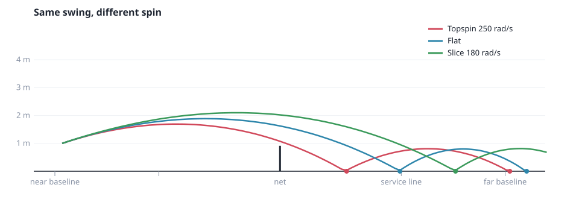

# #2 The ball: flight, bounce and net

*PR 3 of step 1. The physics of a tennis ball: gravity, air drag, spin
bending its path, a bounce where spin matters, and the net. All of it runs
in fixed ticks, without Godot's physics engine.*



!!! abstract "What you'll learn"
    - Why we don't use Godot's physics engine here
    - Fixed-step integration, and why the order of two lines matters
    - Magnus (why topspin dips) and a spin-aware bounce (why topspin kicks)
    - A `Resource` for tunable settings
    - Returning events instead of emitting signals
    - Generating charts from the real code, headlessly

## Read the code in this order

| # | File | What to look for |
|---|---|---|
| 1 | `src/sim/physics_config.gd` | `@export` and `@export_group`: a Resource you can edit in the Inspector |
| 2 | `src/sim/ball.gd` | Plain data, plus `topspin()` and `make_spin()` |
| 3 | `src/sim/ball_event.gd` | An enum and a tiny factory |
| 4 | `src/sim/ball_physics.gd` | `step()` reads top to bottom: air, net, ground |
| 5 | `test/unit/test_ball_physics.gd` | Tests that pin down the *feel* of the ball |
| 6 | `tools/plot_trajectories.gd` | Writing an SVG chart by hand, from a headless script |

## Why not Godot's physics?

Godot has a perfectly good physics engine (`RigidBody3D` and friends). We
don't use it for the ball, for three reasons:

1. **Determinism.** Godot's physics isn't guaranteed to give identical results
   run to run. We want the same inputs to always give the same rally, for
   tests, replays and later netplay.
2. **Fixed, known steps.** Fighting-game-style timing ("the perfect window is 4
   frames") needs the game to advance in exact ticks we control.
3. **Tennis isn't rigid-body physics.** Spin, the Magnus effect and the way a
   ball grips the court are specific. Writing them ourselves is about 100 lines
   and fully under our control.

So `BallPhysics.step()` is a plain function: given a ball and a config, move
it forward 1/60 s.

## Settings as a Resource

```gdscript
class_name PhysicsConfig
extends Resource

@export var gravity: float = 9.81
@export_group("Bounce")
@export var restitution: float = 0.75
```

`@export` makes a property show up in the **Inspector**, and `@export_group`
puts a heading over the ones that follow. Because it's a `Resource`, you can
create one in the editor (**FileSystem → right-click → New Resource →
PhysicsConfig**), tweak numbers, and save it as a `.tres` file. A clay court
later can be just `clay.tres` with more friction.

## The ball

`Ball` is plain data: `position`, `velocity`, `spin`, and `held` (for the
server's toss). Spin is a real **angular velocity vector**: its direction is
the rotation axis, its length the rate in rad/s. Helpers translate to tennis
language:

```gdscript
## Positive is topspin, negative is backspin (slice).
func topspin() -> float:
	var d := Vector3(velocity.x, 0.0, velocity.z)
	return spin.dot(Vector3.UP.cross(d.normalized()))
```

For a ball travelling along **d**, topspin rotates about the axis **up × d**.
Keeping spin as a vector, not "a topspin number", means curve, dip and bounce
all come from the same maths.

## In the air

Three accelerations act on the ball each tick:

```gdscript
var a := Vector3(0.0, -cfg.gravity, 0.0)  # gravity
a -= v * v.length() * cfg.drag             # drag, grows with speed squared
a += ball.spin.cross(v) * cfg.magnus       # Magnus: spin bends the path
```

**Magnus** is why topspin dips and slice floats. A spinning ball drags air
around with it, so air pressure ends up lower on one side. With topspin,
`spin × velocity` points down. The chart at the top of this page shows three
balls with the *identical* launch, differing only in spin, computed by the
real code.

The ball moves with **semi-implicit Euler**:

```gdscript
ball.velocity += air_acceleration(ball, cfg) * dt   # 1. velocity first
ball.position += ball.velocity * dt                  # 2. then move with the NEW velocity
```

Swap those two lines and you get plain ("explicit") Euler, which slowly *adds*
energy to anything that bounces or orbits. Semi-implicit costs the same and
stays stable, which is why most game physics engines use it.

## The bounce

Vertically it's simple: the ball keeps `restitution` (75%) of its downward
speed, reversed. Horizontally, friction acts on the **slip**: how fast the
bottom of the ball skids over the court. That's the ball's velocity plus the
speed its spin gives the contact point:

```gdscript
var contact := Vector3(0.0, -r, 0.0)               # bottom of the ball
var slip := v_t + ball.spin.cross(contact)         # contact-point velocity
var max_friction := cfg.friction * (1.0 + cfg.restitution) * absf(vy)
var to_rolling := 0.4 * slip_speed                 # can't overshoot pure rolling
dv_t = -slip / slip_speed * minf(max_friction, to_rolling)
```

- **Topspin** moves the bottom of the ball *backwards*, cancelling some slip.
  Less braking, and heavy topspin can even push the ball forwards: the **kick**.
- **Backspin** adds slip, so the ball brakes harder and leaves still skidding.
- The same friction also changes the spin: `Δω = (contact × Δv) · 3 / (2r²)`.
  The 3/2, and the 2/5 cap on friction, both come from the moment of inertia
  of a hollow sphere.

!!! note "A test that corrected my intuition"
    I first wrote a test asserting *slice loses more pace than flat on the
    bounce*. It failed: both came out at exactly 13.7 m/s. That's correct
    physics. Both balls slide for the whole contact, so friction brakes them by
    the same amount. What differs is the spin they leave with, and how low slice
    arrives (it floats, then lands at a shallower angle). The test now asserts
    what's true. If we later want an *arcade* slice that skids harder than
    physics allows, that'll be a deliberate, named tuning knob.

## The net

Each tick we compare the ball's Z before and after it moves. If the sign
changed, it crossed the net plane, and linear interpolation finds where:

```gdscript
var t := prev.z / (prev.z - ball.position.z)
var hit := prev.lerp(ball.position, t)
var under_tape := hit.y - cfg.ball_radius < Court.net_height_at(hit.x)
```

At 30 m/s the ball moves 50 cm per tick. Without the interpolation, fast balls
would sometimes jump straight through the net between two ticks. That's
called **tunnelling**, and every physics engine has to handle it.

## Events, not signals

`step()` returns an array of `BallEvent`s (`BOUNCE`, `NET_HIT`, `NET_CROSS`),
each with tick, position and side. Godot's **signals** would also work (any
`Object` can declare them, `RefCounted` included). But return values are
easier to test and keep a guaranteed order, which matters when one tick
contains both a net crossing and a bounce. The referee (devlog #4) consumes
these events.

## Charts from the real code

`tools/plot_trajectories.gd` is a headless script (`extends SceneTree`) that
runs `BallPhysics` and writes an **SVG** file by hand. SVG is just text, so no
plotting library is needed. `./dev media` regenerates it, and the chart on this
page can never drift from the code.

## Try it yourself

1. Set `restitution` to `0.9` and run `./dev media`. Open the SVG: how much
   higher are the bounces?
2. In `_spin_chart()`, add a fourth series with 500 rad/s of topspin. Does it
   clear the net?
3. Write a test: *with `friction = 0`, spin doesn't change pace on the bounce*.
4. Swap the two lines of `integrate_air()` (explicit Euler) and run the tests.
   Which ones notice?
