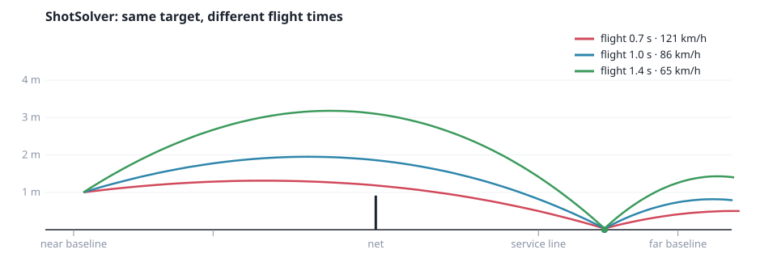
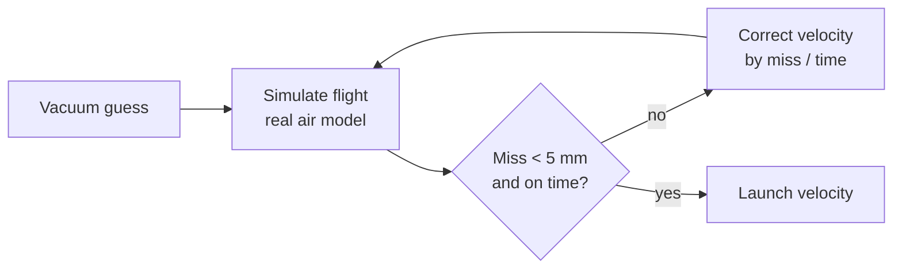

# #3 Aiming: the shot solver

*PR 4 of step 1. Players don't think in velocities. They think "deep to the
corner, hard, with topspin". The shot solver turns that intention into a launch
velocity.*



!!! abstract "What you'll learn"
    - The "shooting method": solving a problem with no formula by simulating it
    - Why flight time is a good way to express shot power
    - Testing numerical code with tolerances

## Read the code in this order

| # | File | What to look for |
|---|---|---|
| 1 | `src/sim/shot_solver.gd` | `solve()`: a guess, then a correction loop |
| 2 | `test/unit/test_shot_solver.gd` | Five shot styles in one parameterised test |
| 3 | `tools/plot_trajectories.gd` | The new `_flight_time_chart()` |

## The problem

Given where the ball is, where it should land, how long the flight should
take, and what spin it has, find the launch velocity.

Without air, that's high-school physics:

```gdscript
var v := Vector3(
	(target.x - from.x) / t,
	(land_y - from.y + 0.5 * cfg.gravity * t * t) / t,
	(target.z - from.z) / t
)
```

With drag and Magnus there's no neat formula. The ball slows down, and spin
bends it, by amounts that depend on its speed.

## The shooting method

Use the vacuum answer as a first guess. Then fly the ball with the **real** air
model, see where it lands, and correct the guess by the miss. Repeat:

```gdscript
for i in ITERATIONS:
	var landing := simulate_landing(from, v, spin, cfg)   # x, flight time, z
	var miss := Vector3(target.x - landing.x, 0.0, target.z - landing.z)
	v.x += miss.x / t
	v.z += miss.z / t
	v.y += (t - landing.y) * cfg.gravity * 0.5            # fix the timing
```

The name comes from artillery: fire, see where the shell lands, adjust. Twelve
rounds land within millimetres. Because `simulate_landing()` uses the same
`BallPhysics.integrate_air()` as the real game, the solver can never disagree
with the ball it's aiming. Because the simulation is deterministic, so is the
answer.



`simulate_landing()` packs (x, flight time, z) into one `Vector3` rather than
allocating a result object. It's a small trick worth knowing for hot loops in
GDScript.

## Flight time is power

The chart at the top shows the same target reached in 0.7, 1.0 and 1.4 seconds.
Shorter means harder and flatter (121 km/h), longer means a loopy, safe ball
(65 km/h). This is how shot types will work in step 3: a topspin, a slice or a
lob will each be a recipe for **flight time + spin + target offset**, scaled by
charge and character stats. The solver turns any recipe into a velocity.

## Testing numerical code

You can't `assert_eq` floats from an iterative solver. Use tolerances that
express what matters to the game:

```gdscript
assert_almost_eq(landing.x, target.x, 0.02, "x")      # 2 cm is invisible
assert_almost_eq(landing.y, p[2], 0.05, "flight time") # 3 ticks
```

And test the *relationship*, not just individual numbers:
`test_shorter_flight_time_means_a_harder_shot`.

## Try it yourself

1. Set `ITERATIONS` to 1, 3 and 6. At what point do the tests start passing?
2. Add a row to `test_lands_on_target` for a lob: 2.5 s flight with backspin.
3. What happens with an impossible request, like 0.1 s across the whole court?
   Write a test for what you think *should* happen.
