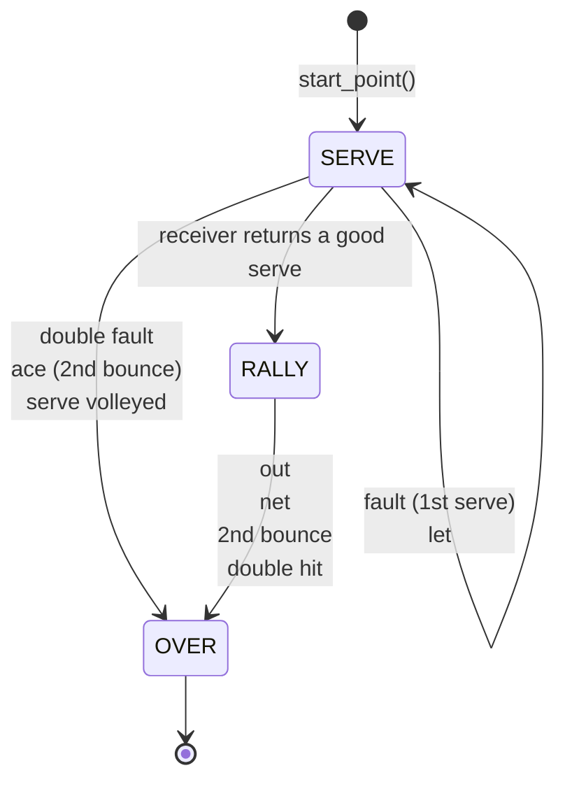
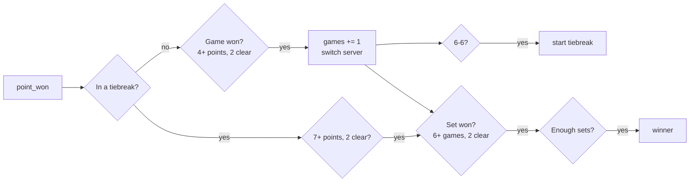

# #4 The rules: referee and scoring

*PR 5 of step 1. Tennis rules as two small, separate pieces of logic: a
referee that rules on a single point, and a scorer that turns points into
games, sets and a match. Neither knows anything about physics.*

!!! abstract "What you'll learn"
    - Modelling rules as a state machine fed by events
    - Inner classes in GDScript
    - A `Resource` with presets (`static func` factories)
    - Testing rules with hand-made events instead of physics

## Read the code in this order

| # | File | What to look for |
|---|---|---|
| 1 | `src/sim/referee.gd` | The four facts it tracks, then `_on_bounce()` |
| 2 | `test/unit/test_referee.gd` | Each test is one tennis situation |
| 3 | `src/sim/match_format.gd` | Presets as `static func`s |
| 4 | `src/sim/match_score.gd` | `point_won()`, then `_tiebreak_server()` |
| 5 | `test/unit/test_match_score.gd` | Love games through best of five |

## The referee

The rules of one point are a small **state machine**. It takes two kinds of
input, `on_hit(side)` and `on_ball_event(e)`, and answers each with a
`Ruling`: nothing, `FAULT`, `LET`, or `POINT` with a winner and a reason.



Since the last hit, it remembers just four facts: **who** hit it, has it
**crossed** the net, how many times has it **bounced** on the far side, and did
it **touch the net**. Every rule we need follows from those:

| Situation | Ruling |
|---|---|
| First bounce in the opponent's court (service box when serving) | play on |
| First bounce outside it | `OUT`, or a fault on a serve |
| Bounces on the hitter's own side (it never crossed) | `NET`, or a fault |
| Second bounce anywhere | point to the last hitter |
| Serve clips the net and lands in | `LET`, same serve again |
| Receiver hits the serve before it bounces | point to the server |
| Same side hits twice | point to the other side |

### Inner classes

```gdscript
class_name Referee
extends RefCounted

class Ruling:
	enum Kind { NONE, FAULT, LET, POINT }
	var kind := Kind.NONE
	var winner := Side.NONE
```

A `class` inside another script is an **inner class**. From outside it's
`Referee.Ruling`. That's good for small types that only make sense next to
their owner, and it saves a file.

### Testing without physics

The referee doesn't care where events come from, so the tests make them by
hand. Each test reads like a tennis situation:

```gdscript
func test_net_cord_serve_that_lands_in_is_a_let() -> void:
	ref.on_hit(Side.NEAR)
	_net()
	_cross(Side.FAR)
	assert_eq(_bounce(IN_BOX).kind, R.LET)
	assert_eq(ref.serve_number, 1, "a let replays the same serve")
```

This is the payoff of separating the rules from the physics: twelve tests,
every rule covered, all running in milliseconds.

## Scoring

`MatchScore` is tennis's odd counting system as code: points → games → sets →
match, with deuce/advantage (or no-ad), tiebreaks at 6-all, and who serves
next from which side. You feed it `point_won(side)` and read the rest.



### Formats are a Resource with presets

| Preset | Rules |
|---|---|
| `MatchFormat.quick_tiebreak()` | First to 7 points, win by 2. **The v1 default** |
| `MatchFormat.first_to(n)` | First to *n*, optionally without win-by-two |
| `MatchFormat.one_set()` | Six games, tiebreak at 6-6 |
| `MatchFormat.best_of(3)`, `best_of(5)` | Proper sets |

A `static func` that builds and returns a configured object is a **factory**.
It's the simplest way to offer presets for a `Resource` in code, and a menu
can list them with `MatchFormat.presets()`.

### The tiebreak serving trap

In a tiebreak, the first server takes one point, then players alternate every
**two** points: A, BB, AA, BB... Once you see the pattern it's one line:

```gdscript
var block := (points_so_far + 1) / 2
return first_server if block % 2 == 0 else Side.other(first_server)
```

And one test pins it down: `assert_eq(order, [a, b, b, a, a, b, b])`.

## Try it yourself

1. Add a "Fast4" preset: sets to 4 games, no-ad, tiebreak at 3-3. Write its
   tests first.
2. A rally ball that clips the net tape and still drops over is good in real
   tennis. Write a test that proves our referee agrees (hint: `NET_HIT`,
   then `NET_CROSS`, then a bounce in).
3. `point_text()` calls the server's score first, like an umpire. Add a test
   for "Ad NEAR" when FAR is serving.
