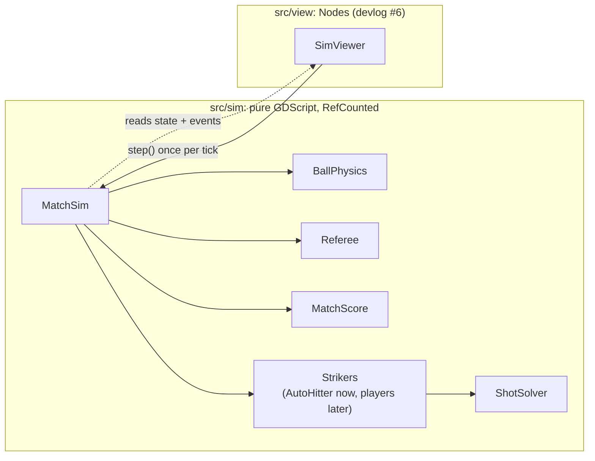
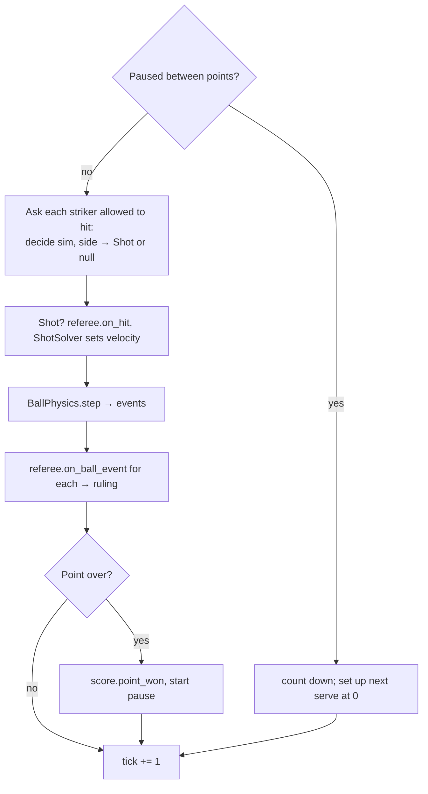

# #5 The match loop and determinism

*PR 6 of step 1. Everything so far comes together in `MatchSim`, which plays
a whole match one tick at a time. Two "ball machine" bots stand in for players,
and the tests prove a match replays identically from its seed.*

!!! abstract "What you'll learn"
    - The fighting-game loop: state in, one tick, state out
    - Duck typing in GDScript: an interface without declaring one
    - Seeded randomness with `RandomNumberGenerator`
    - Determinism tests and the "golden master" technique

## Read the code in this order

| # | File | What to look for |
|---|---|---|
| 1 | `src/sim/shot.gd` | What a striker asks for |
| 2 | `src/sim/match_sim.gd` | `step()`, then `_handle()` and `_setup_point()` |
| 3 | `src/sim/bots/auto_hitter.gd` | `decide()`: the striker "interface" |
| 4 | `test/integration/test_match_sim.gd` | Replay and golden-master tests |

## Simulation and view

Fighting games run on a strict loop: read inputs, advance the game state by
exactly one frame, then draw it. The state never depends on how fast the
screen renders. Everything we want from Aces-style mechanics needs that: frame
data, hit windows, perfect-timing bonuses, replays, maybe online play.

So the whole game is split in two. Everything up to this PR is the left side:



The simulation has no idea that time passes in the real world. It only has
`step()`. Consequences:

- **Tests are instant.** A whole one-set match (about 75,000 ticks, 21 minutes
  of play) simulates in well under a second.
- **Determinism is achievable.** The only randomness is a seeded
  `RandomNumberGenerator`, and the only clock is the tick counter.
- **The view is replaceable.** Step 2 tries two different cameras over the
  same simulation.

## One tick



## Strikers and duck typing

A **striker** is anything with this method:

```gdscript
func decide(sim: MatchSim, side: int) -> Shot
```

`MatchSim` stores strikers in an untyped array and calls `decide()` on them.
GDScript checks at run time that the method exists. There's no `interface`
keyword, so this "if it quacks like a duck" style is the idiomatic way to
plug things in. Players and the CPU in later steps will be strikers too.

`AutoHitter` is a ball machine with opinions. It has no body: it hits any ball
that has bounced once and is falling below 1 m, wherever it is, aims at a
random spot with a random spin style, and misses on purpose 12% of the time.
It exists to exercise everything else before real players exist.

## Determinism

All randomness goes through `sim.rng`:

```gdscript
var rng := RandomNumberGenerator.new()
rng.seed = p_seed
```

Never the global `randf()`, which any code anywhere could also be calling.
Two tests guard it. The first compares two matches with the same seed **every
tick**:

```gdscript
for i in 3000:
	a.step()
	b.step()
	if a.state_hash() != b.state_hash():
		fail_test("diverged at tick %d" % i)
		return
```

Checking every tick, not just the end, means a failure points at the exact
tick where the two runs split.

The second is a **golden master**: seed 42, one set, must end **4-6 after 75
points**. Any change to physics, rules or the bot changes that result. That
can be fine, but then you update the expected numbers *on purpose* and say why
in the commit.

??? note "Will it be identical on every machine?"
    Same binary, same platform: yes. Across CPUs or between the desktop and
    WebAssembly builds, floating-point rounding can differ in rare cases. That
    only matters for online play, and when we get there the fix is known:
    run the simulation in fixed-point integers.

## Try it yourself

1. Run `./dev test -gselect=test_match_sim` and read the golden-master line in
   the output.
2. Set `AutoHitter.error_rate` to `0.0`. Do matches still end? (Bots can't be
   passed, since they have no bodies.)
3. Make the bot sneakily non-deterministic by using `randf()` instead of
   `rng.randf()` in one place. Which test catches it, and at which tick?
