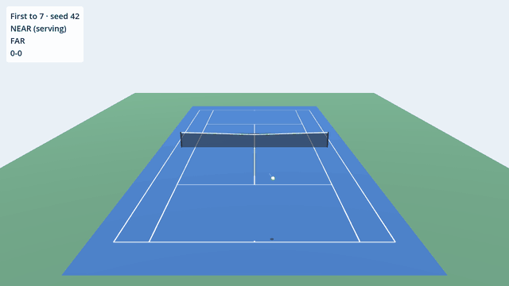
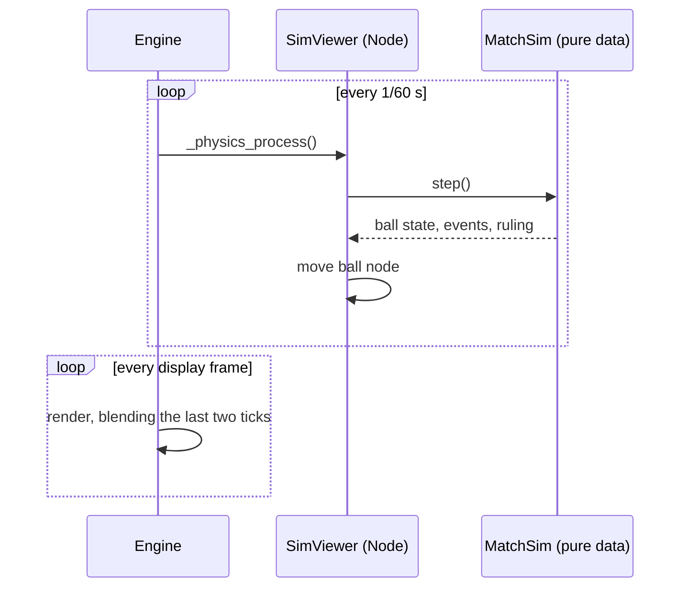
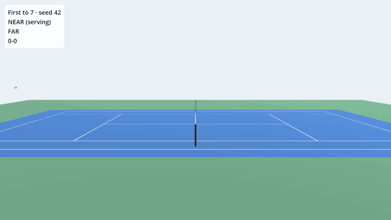

# #6 Seeing it: a 3D scene built from code

*PR 7 of step 1. The first thing you can actually watch. A debug viewer that
draws the simulation in 3D, with every mesh generated at runtime and no
imported assets.*



!!! abstract "What you'll learn"
    - A scene with one node, where `_ready()` builds the rest
    - Primitive meshes, materials and `ImmediateMesh`
    - `_physics_process` vs `_process`, and **physics interpolation**
    - `CanvasLayer` for a HUD
    - Command-line arguments for a Godot game
    - Recording footage with **Movie Maker mode**

## Read the code in this order

| # | File | What to look for |
|---|---|---|
| 1 | `scenes/sim_viewer.tscn` | One node and a script. That's the whole scene |
| 2 | `src/view/sim_viewer.gd` | `_ready()` builds the world; `_physics_process()` steps the sim |
| 3 | `src/view/court_builder.gd` | Meshes sized from `Court` constants |
| 4 | `src/view/ball_view.gd` | Ball, shadow, trail; `snap()` vs `sync()` |
| 5 | `src/view/palette.gd` | Every colour in one place |
| 6 | `project.godot` | The new `run/main_scene` line |
| 7 | `dev` | `cmd_run`, and `capture()` for GIFs |

## Run it

```bash
./dev run                                         # broadcast camera, first to 7
./dev run --seed=7 --camera=side --format=best_of_3
```

Arguments after a lone `--` are for the game, not the engine. The script reads
them with `OS.get_cmdline_user_args()`.

## A scene that builds itself

`scenes/sim_viewer.tscn` is five lines:

```ini
[gd_scene format=3]
[ext_resource type="Script" path="res://src/view/sim_viewer.gd" id="1_viewer"]
[node name="SimViewer" type="Node3D"]
script = ExtResource("1_viewer")
```

Usually you'd build the camera, light and meshes in the editor. Here
`_ready()` creates them with `Node.new()` + `add_child()`. That fits a game
with zero assets, keeps every size tied to the simulation's constants, and
makes PRs readable as code. The editor still shows the result: run the
scene with F6 and open the **Remote** tab of the Scene dock to inspect the
live tree.

- **`CourtBuilder`** makes the court from `PlaneMesh` and `BoxMesh`, sized from
  the same `Court` constants the referee uses, so what you see is what's ruled
  on. Lines sit 2 mm above the surface to avoid **z-fighting** (two surfaces at
  the same depth flicker, because the GPU can't decide which is in front).
- **`BallView`** draws the ball at 2.2x real size (real balls vanish at
  broadcast distance, and every tennis game cheats this). Below it goes a dark
  disc as a **shadow**, the most important depth cue in any 3D ball game and
  cheaper than real shadow mapping. Behind it, a fading **trail** is rebuilt
  every tick with `ImmediateMesh`, Godot's API for geometry that changes every
  frame.
- **`Palette`** holds every colour: one `StandardMaterial3D` per colour, no
  textures anywhere.
- The **HUD** lives in a `CanvasLayer`, which draws on top of the 3D view and
  ignores the camera.

## Ticks, frames and physics interpolation

Godot calls two different callbacks:

| Callback | When | Rate | We use it for |
|---|---|---|---|
| `_physics_process(delta)` | Fixed steps | `physics_ticks_per_second` (60) | Stepping the sim, moving nodes |
| `_process(delta)` | Once per rendered frame | Whatever the monitor runs (60, 144, ...) | Nothing yet |

On a 144 Hz screen, several frames render between two ticks, and the ball
would visibly step. **Physics interpolation** (enabled in devlog #0's
`project.godot`) fixes that: Godot remembers each node's transform at the last
two ticks and blends between them on every frame.



When the ball **teleports** (a new point starts), blending would draw a streak
across the court. `reset_physics_interpolation()` says "don't blend this one",
which is what `BallView.snap()` is for. The trail turns interpolation off
entirely (`physics_interpolation_mode = OFF`), because it's rebuilt in world
space every tick.

## Footage without a screen: Movie Maker mode

Godot can render to image files instead of a window:

```bash
godot --write-movie out/frame.png --fixed-fps 30 --quit-after 300 -- --seed=42
```

`--fixed-fps` makes the engine pretend exactly 1/30 s passes per frame, however
long rendering really takes. With our deterministic simulation, **the same
command always produces the same frames**. `./dev media` does this for two
cameras, and when there's no display it runs Godot under **Xvfb** (a virtual
X server) with software OpenGL. Then `ffmpeg` turns the frames into a GIF using
a two-pass palette, which keeps files small. The GIFs on this page come from
exactly that.



## Try it yourself

1. `./dev run --camera=high` for a top-down view. Add a fourth camera to
   `CAMERAS`: low, behind the far baseline.
2. Change `Palette.COURT` to a clay colour (`#c8693a`). Everything else
   follows.
3. Turn off **Physics → Common → Physics Interpolation**, run on a high
   refresh-rate monitor, and watch the ball. Can you see it stutter?
4. Make the shadow fade as the ball rises, not just shrink. Look at
   `BallView.sync()`.
