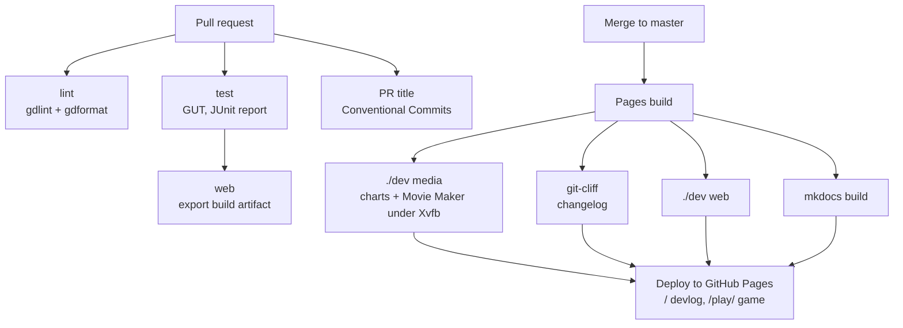

# #7 Shipping it: web export and CI/CD

*PR 8 of step 1. Every pull request is checked automatically, and every
merge publishes this devlog and a playable web build to GitHub Pages.*

!!! abstract "What you'll learn"
    - Export presets and templates, and what makes a Godot web build work on
      GitHub Pages
    - GitHub Actions: workflows, jobs, caching, a reusable composite action
    - Conventional Commits and a generated changelog

## Read the code in this order

| # | File | What to look for |
|---|---|---|
| 1 | `export_presets.cfg` | `thread_support=false` and `exclude_filter` |
| 2 | `dev` | `cmd_templates` and `cmd_web` |
| 3 | `.github/actions/setup-godot/action.yml` | A reusable step with caching |
| 4 | `.github/workflows/ci.yml` | Three jobs on every PR |
| 5 | `.github/workflows/pr-title.yml` | The Conventional Commits check |
| 6 | `.github/workflows/pages.yml` | Build everything, deploy to Pages |
| 7 | `cliff.toml` | How commits become the changelog |

## Exporting for the Web

Exporting needs **export templates**: prebuilt engine binaries for each
platform. The full download is 1.3 GB, but the web build only needs
`web_nothreads_release.zip` (10 MB), so `./dev templates` keeps just that.

`export_presets.cfg` is what **Project → Export...** writes. We have one
preset, `Web`. Two options matter:

- `variant/thread_support=false`: a multi-threaded web build needs special
  HTTP headers (cross-origin isolation) that GitHub Pages can't send. The
  single-threaded build runs anywhere.
- `exclude_filter="test/*, tools/*, docs/*, addons/gut/*"`: tests and tools
  stay out of the shipped game.

The result is about 10 MB gzipped. Nearly all of that is the engine itself; the
game's own data is **40 KB**.

## CI/CD



Every job calls the same `./dev` commands you run locally. If CI fails, you
can reproduce it with one command.

- **`ci.yml`** runs on every PR: lint, tests, and a web export to prove the
  game still builds. The test report and the web build are uploaded as
  **artifacts** you can download from the run page.
- **`pr-title.yml`** checks the PR title follows
  [Conventional Commits](https://www.conventionalcommits.org) (`feat:`,
  `fix(sim):`, `docs:`...). PRs are squash-merged, so the title becomes the
  commit message, and the changelog is built from those.
- **`pages.yml`** runs on `master`: regenerates every chart and GIF from the real
  game, builds the changelog with [git-cliff](https://git-cliff.org), exports
  the game, builds this site with
  [MkDocs Material](https://squidfunk.github.io/mkdocs-material/), and deploys
  both.

### A composite action

`.github/actions/setup-godot/action.yml` is our own reusable step: install
the Godot version from `.godot-version`, optionally the web templates, then
import the project. Both workflows use it with one line:

```yaml
- uses: ./.github/actions/setup-godot
  with:
    templates: "true"
```

It **caches** the Godot download and the templates with `actions/cache`, keyed
on the version. The first run downloads them; later runs restore them in
seconds. Bumping the engine is a one-line change to `.godot-version`.

## Try it yourself

1. `./dev templates && ./dev web`, then serve it: `cd build/web && python3 -m
   http.server`. Open http://localhost:8000.
2. Open a PR titled "updated stuff" and watch the title check fail. Rename it
   to `docs: fix typo` and watch it pass.
3. After the next merge, open the **Actions** tab and read the Pages run's log
   for the Movie Maker step.
