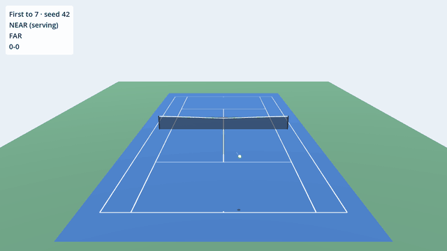

# 40 love

A minimalist, procedurally generated arcade tennis game for the browser, with a
deep, fighting-game-like shot system inspired by *Mario Tennis Aces*. Same
spirit, our own characters and look. It's built in **Godot 4** and documented step by step as a way to learn
the engine.

[Play the latest build](https://morbeo.github.io/40-love/play/){ .md-button .md-button--primary }
[Source on GitHub](https://github.com/morbeo/40-love){ .md-button }

## How to read this devlog

Each entry matches one step of the plan and one pull request. Every entry has:

- **Design**: what we decided, what else we considered, and why.
- **Godot**: the engine features used, how to reach them in the editor, and
  why Godot works that way.
- **Code walkthrough**: the important scripts, and how data flows between them.
- **Visuals**: diagrams, charts and footage. The charts and footage are
  regenerated from the real game on every deploy, so they never go stale.
- **Try it yourself**: small experiments to poke at what the entry built.

## The plan

| Step | What | Status |
|---|---|---|
| 1 | Foundation: project, tested simulation core, CI/CD, devlog | [#0](devlog/000-setup.md), [#1](devlog/001-sim-core.md) |
| 2 | Camera spike: fake-3D vs real 3D, keyboard + gamepad | next |
| 3 | Shot system: full shot matrix, meter, trick/zone/special shots, training mode | |
| 4 | Playable match: procedural characters, CPU, match presets, procedural look and sound | |
| later | Court surfaces, wind, mobile | |

## Ground rules

- **Zero imported assets.** Meshes, colours, and later sounds are all generated
  in code.
- **The simulation is pure and deterministic.** Same seed + same inputs = same
  match, every time. That makes it testable and replayable.
- **Test first.** Every rule of tennis and every mechanic gets a test before it
  gets a feature.
